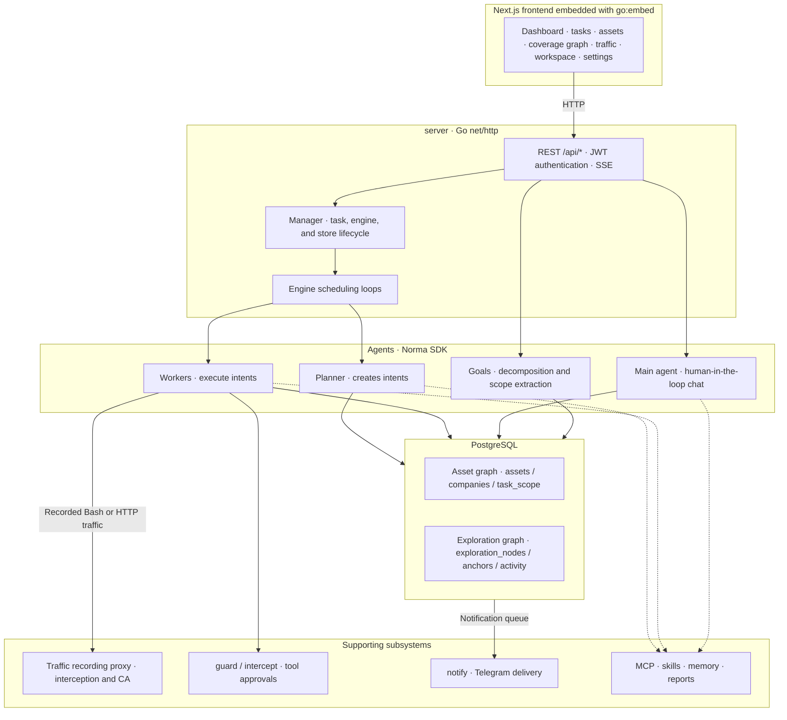
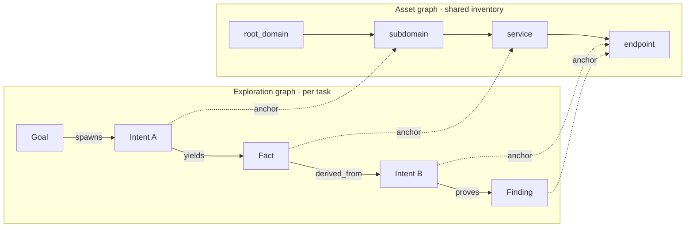
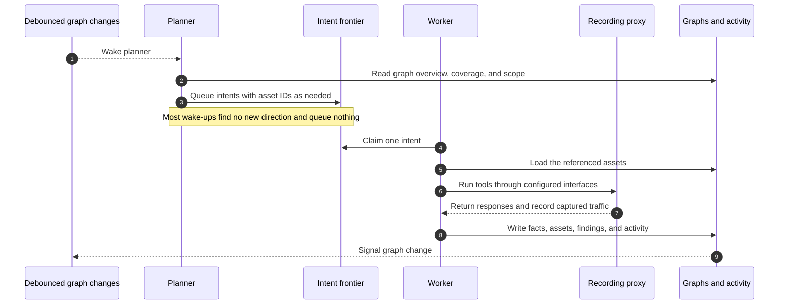
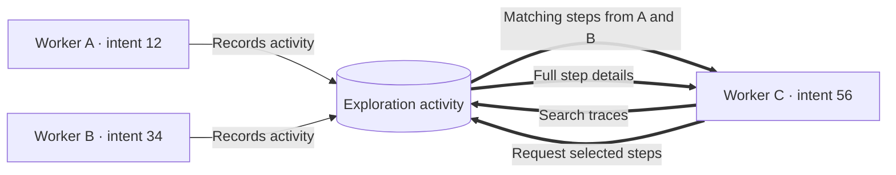
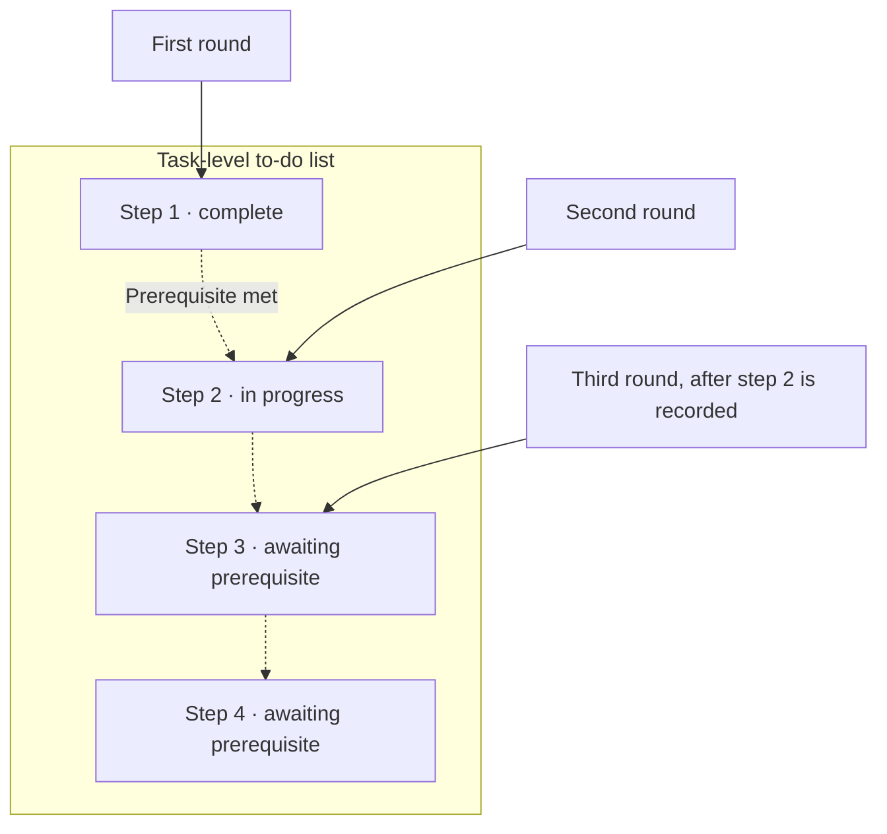

<div align="center">

# ARTEX

An AI-driven penetration testing platform with a Go backend and a Next.js frontend.

[English](README.md) · [简体中文](README.zh-CN.md)

</div>

---

## Rust inspection console

The Rust workspace provides a read-only Ratatui client for browsing legacy PostgreSQL records. The Go application remains the operational deployment covered below. See the [Rust setup and verification runbook](docs/migration.md).

## Approval details

Expand an entry in the global approval log, a task's approval view, or an approval card in chat to see its details. ARTEX uses its own components and theme, with the detail layout based on [AegisHook's approval detail component](https://github.com/RuoJi6/AegisHook/blob/main/web/src/components/CallDetail.vue).

## Asset synchronization with ScopeSentry

ARTEX imports existing asset records directly from [ScopeSentry](https://github.com/Autumn-27/ScopeSentry). Enter the ScopeSentry URL and API key on the Asset Sync page, then select a project or task and the asset types to import. ARTEX reconciles the imported records with organization scope and adds them to the asset graph. Supported types include domains, subdomains, IP addresses, ports, sites, and endpoints.

---

## Installation

ARTEX builds from source on Linux amd64 and arm64. You need Bash, Go 1.26.3 or later, and access to PostgreSQL. Building the embedded frontend also requires Node.js 22 or later and npm. Use Git to clone or update the checkout. Install the tools required by the skills and MCP servers you enable, and make their executables available on the ARTEX process's `PATH`.

### PostgreSQL setup

Prepare a local or externally managed PostgreSQL database. Give the ARTEX database account permission to create and migrate application tables. Set the connection in `config.toml` or supply `ARTEX_PG_DSN`, which takes precedence. Use `ARTEX_CONFIG` to select a different configuration file. See [legacy configuration migration](#legacy-configuration-migration) for existing JSON files. For remote databases, configure the appropriate CA and use `ssl_mode = "verify-full"` in TOML or `sslmode=verify-full` in the DSN.

### Build and start

```bash
git clone https://github.com/Clementine-Miles/ARUSTEX.git ARTEX
cd ARTEX
test -e config.toml || (umask 077; cp config.example.toml config.toml)
# Edit config.toml to configure PostgreSQL, or set ARTEX_PG_DSN.
./install.sh -addr 127.0.0.1:8787
```

You can skip creating `config.toml` if `ARTEX_PG_DSN` is already set. The install script builds the current source and starts ARTEX. The application reads and validates the configuration. On first use, visit `http://127.0.0.1:8787/setup` to set the administrator password. Before running agents, configure a provider on the LLM Configuration page or set `ANTHROPIC_API_KEY` or `OPENAI_API_KEY`.

To prepare an executable before starting the service, run the build and startup scripts separately.

```bash
./build.sh
./start.sh -addr 127.0.0.1:8787
```

By default, the build embeds the Next.js static frontend in the `artex` executable at the project root. Pass `--backend-only` to `build.sh` or `install.sh` to build just the Go backend. Go and npm resolve missing dependencies during the build. The startup script runs the existing local executable. Use Ctrl+C in the foreground or send SIGTERM through the service manager for graceful shutdown.

---

## Upgrading

Back up PostgreSQL, the application configuration, `data/`, `jwt.key`, and `skills/`, or their configured locations. Keep the same database and directories to retain task data, credentials, and installed skills. To move to a new database instance, restore the backup before changing the connection settings. ARTEX applies schema migrations at startup. If the existing installation still uses JSON configuration, [convert it to TOML](#legacy-configuration-migration) before restarting.

```bash
./update.sh
# Fast-forward from the configured Git upstream before building.
./update.sh --pull
```

Choose one of the two commands. By default, the script builds the current worktree. `--pull` first fast-forwards from the configured Git upstream. For a backend-only deployment, also pass `--backend-only`. A failed build leaves the previous executable in place. After a successful build, let running tasks finish, stop the current process, and start it again with the original arguments. For a managed installation, restart the service through its service manager.

---

## Configuration

ARTEX uses TOML for application configuration. Export runtime overrides in the ARTEX process environment. npm, TypeScript, Biome, and shadcn use their own JSON manifests, Next.js and PostCSS use JavaScript modules, and GitHub Actions uses YAML.

```toml
[database]
host = "127.0.0.1"
port = 5432
user = "artex"
password = ""
db_name = "artex"
ssl_mode = "disable"

[skills]
directory = ""
```

`ARTEX_CONFIG` takes precedence. Otherwise, ARTEX looks for `config.toml` in the working directory first and the executable directory second. If the selected location contains only a legacy `config.json`, ARTEX stops and requests migration. It also rejects JSON selected through `ARTEX_CONFIG`. Unknown TOML keys and parse errors stop startup.

`ARTEX_PG_DSN` overrides `[database]`. Within the table, you can set `dsn` to a complete connection string or supply the individual connection fields. The component defaults are `127.0.0.1` for `host`, `5432` for `port`, and `disable` for `ssl_mode`. `ARTEX_SKILL_DIR` overrides `[skills].directory`. An empty directory defaults to `skills/` beside the executable. Relative paths resolve from the working directory.

### Legacy configuration migration

Build the local executable, then convert the legacy file. The output uses the same base name with a `.toml` extension in the same directory.

```bash
./build.sh --backend-only
./artex -migrate-config config.json
```

Migration preserves database connection details and the skill directory. It writes an owner-readable and owner-writable TOML file, retains the original JSON, and refuses to overwrite an existing destination. The new file contains the original credentials, so protect both files. Update `ARTEX_CONFIG` if you set it explicitly. In an already built installation, `./reset-password.sh` resets the administrator password using the application's configuration resolver.

### Runtime options

- **LLM providers.** Enter credentials on the LLM Configuration page or set `ANTHROPIC_API_KEY` or `OPENAI_API_KEY`. Optional overrides include `ARTEX_LLM_PROVIDER`, `ARTEX_LLM_MODEL`, `ARTEX_LLM_BASE_URL`, and `ARTEX_LLM_PROXY`.
- **Concurrency.** System Settings controls the number of workers per task. The default is three.
- **Listen addresses.** For example, run `./start.sh -addr 127.0.0.1:8787 -proxy 127.0.0.1:8788`. `-addr` sets the frontend and API address, which defaults to `:8787`. `-proxy` sets the traffic recording proxy address, which defaults to `127.0.0.1:8788`. An empty proxy address disables it. The startup script forwards these arguments to `artex`.
- **Remote MCP servers.** System Settings supports `http` for Streamable HTTP and `sse` for legacy SSE. A legacy SSE URL commonly ends in `/sse`. The server announces its JSON-RPC endpoint on the event stream. Configure request headers such as `Authorization=Bearer <token>` for trusted MCP servers.
- **Telegram notifications.** Configure the bot token, chat ID, and optional Bot API URL on the Notifications page. Each destination has its own filters, rate limits, and immediate or digest delivery mode. Changing the Bot API URL requires re-entering the bot token. Deliveries connect directly to the Bot API and bypass HTTP proxy environment variables. A custom Bot API URL may contain a path prefix. Enter credentials separately and keep user information, query strings, and fragments out of the URL. Records for retired notification channels remain in PostgreSQL. ARTEX hides them from the notification interface and stops delivering to those destinations.

### HTTPS reverse proxy

Run ARTEX with `-addr 127.0.0.1:8787` and expose port 443 through a reverse proxy on the same host. The frontend, API, and SSE streams share the backend's port. The frontend uses the page's origin for activity streams by default.

Keep reverse proxy buffering disabled for SSE so the browser receives events as they arrive. The Nginx configuration below illustrates the required settings.

```nginx
server {
    listen 443 ssl;
    server_name your.domain.com;
    # ssl_certificate / ssl_certificate_key ...

    location / {
        proxy_pass http://127.0.0.1:8787;
        proxy_set_header Host $host;
        proxy_set_header X-Forwarded-Proto $scheme;

        # Disable buffering and use a long read timeout for SSE.
        proxy_buffering off;
        proxy_cache off;
        proxy_read_timeout 3600s;
        proxy_http_version 1.1;
        proxy_set_header Connection "";
    }
}
```

If SSE uses a different origin, such as a dedicated subdomain, set `NEXT_PUBLIC_SSE_BASE` before running `next build`. The build embeds this value in the static frontend.

---

## Development

### Manual vulnerability retesting

Use the Retest tab in a task to browse its findings, review previous conclusions and evidence, and start manual retests. The tab remains open while a progress icon and retest status show the run. A confirmed fix updates the finding's status.

To start from another view, choose Retest in the findings list or Start Retest in the finding's detail view. Supply the fix version, testing conditions, or constraints if needed. ARTEX creates a dedicated retest agent session while keeping the current page open. The flat list, task grouping, and asset view all offer this action. Open the running session to see its progress. The Retest action becomes available again when the session finishes. Retests run independently of the original scan. The outcomes are still reproducible, fixed, and inconclusive. Each retest's conclusion, evidence, and session link stay with the finding.

On first startup, the current backend seeds an editable retest agent named `retester`. Configure its prompt, model, run budget, and tools in Agent Management. It uses its assigned LLM or falls back to the active global provider. A completed retest with a fixed outcome changes the finding's status to fixed. All other outcomes preserve the existing status. The original evidence and report are retained. You can also mark a finding fixed through the status menu. ARTEX reuses an active retest session for the same finding. You can start another after the session stops, fails, or the service restarts.

Retest history is available in finding details and sessions. Vulnerability report exports and task archives currently omit this history. Traffic captures require a separate association. Demo mode displays clearly labeled mock records.

### Local development and testing

Configure a development PostgreSQL database, then run the following from the project root. Open `http://127.0.0.1:5173` to use the frontend with hot reload. The development server proxies `/api` to the local backend.

```bash
(cd web && npm ci)
./dev.sh
```

The development backend listens on loopback port 8787 and the traffic proxy on loopback port 8788. To run just the backend, use `go run ./cmd/artex -addr 127.0.0.1:8787`. For a local frontend preview with mock data, use `cd web && NEXT_PUBLIC_MOCK=1 npm run dev -- --hostname 127.0.0.1`.

```bash
go test ./...
go vet ./...
(cd web && npm run build:static)
```

Point `ARTEX_PG_DSN` at a dedicated test database before running the full Go suite. Some tests require PostgreSQL and write to that database. The static frontend build includes TypeScript checks.

The opt-in `TestLiveContextReview` reads a private TOML file selected by `ARTEX_REVIEW_LIVE_CONFIG`. Its `[judge]` table accepts `base_url`, `api_key`, and `model`. Keep this file outside the checkout.

---

## Architecture

ARTEX combines a Go monolith, an embedded Next.js frontend, and PostgreSQL. Its LLM-driven agents use the [Norma SDK](https://github.com/Autumn-27/norma) for agent execution, tools, permissions, safeguards, memory, and transcripts. Two graphs underpin the architecture. Workers can share observations from their execution histories, and the planner retains a task-level to-do list across rounds.

### System layers



| Layer | Responsibility |
| --- | --- |
| **Frontend** | A Next.js static export embedded in the executable with `go:embed`. Displays tasks, assets, exploration paths, coverage, and human-in-the-loop chat. |
| **Server** | Handles `net/http` routing, JWT authentication, and SSE. The `Manager` owns task, engine, and store lifecycles. |
| **Engine** | Runs one `plannerLoop` and multiple worker goroutines per task. Coordinates intent claims, timeouts, pauses, and draining. |
| **Agents** | Goal, planner, worker, and main-agent roles. `ToolSet` provides LLM tools for interacting with the two graphs. |
| **Persistence** | Stores both graphs in PostgreSQL through pgx. An embedded schema runs idempotently at startup. |
| **Supporting services** | Traffic recording, approvals, Telegram notifications, MCP, skills, and reports. |

### Asset and exploration graphs

- **Asset graph.** A shared inventory across tasks. Nodes represent root domains, subdomains, IP addresses, services, applications, and endpoints, with organization associations. ARTEX derives parent-child relationships and deduplication keys from the asset records agents submit.
- **Exploration graph.** A record of each task's progress. It contains goals, intents, facts, findings, and hints. Edges such as `spawns`, `derived_from`, `yields`, and `proves` preserve the relationship between observations and conclusions.
- **Anchors.** `exploration_anchors(node_id, asset_id)` connects intents, facts, and findings to assets. This lets the UI show which assets an intent covered and retrieve the observations linked to a particular asset in a task. The same links support scope-aware coverage reporting.



The planner reads the task's graph and dispatches an intent when there is an uncovered direction to investigate. Each worker claims one intent, records any new assets, facts, and findings, then finishes that unit of work. The asset graph provides shared context while the exploration graph records progress for each task.

### Engine and intent lifecycle

The engine is event-driven. Graph changes wake the planner, which can add intents to the frontier. Workers claim them and persist their results. Those writes can trigger another round. A goal can be closed through `prove_goal`.



### Sharing observations between workers

Useful observations can appear in a worker's execution history before becoming formal facts. Workers can look up observations from other intents in the same task to avoid repeating work. `search_all_worker_traces(q)` searches by keyword, excludes the current intent, and includes the source `intent_id` in matches. `list_worker_traces` lists available traces, and `get_worker_trace(intent_id, step_ids=[…])` fetches specific steps. Each worker stays assigned to its own intent.



### Task-level planning across rounds

Some tasks contain steps whose prerequisites must be satisfied in order. Each planner wake-up starts a new session, and a task-level to-do list carries the plan across sessions. The planner can use recorded facts to mark completed work and decide which pending step is ready. This keeps dependency tracking in the task state.



---

## References and licensing

- [Cairn](https://github.com/oritera/Cairn)

ARTEX is licensed under [AGPL-3.0](LICENSE). The frontend's MIT-licensed materials and copyright notices are listed in [web/LICENSE](web/LICENSE).
