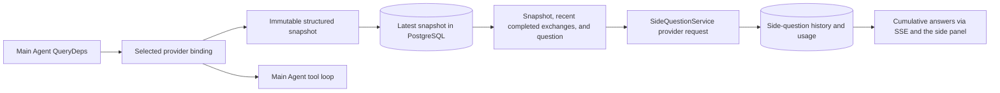

# ARTEX `/btw`

Use `/btw your question` in the main input to ask a side question in chat, a task's MainAgent conversation, or a Worker assigned to that task. Enter `/btw` by itself or select the side-question button to open the history. On desktop, the panel is a resizable sidebar. On mobile, it opens in a drawer.

Each answer uses the Agent context captured when the question is submitted. You can follow the answer as it streams, ask a follow-up, stop the request, or clear the history. The request continues if you close the panel, reload the page, or lose the SSE connection. Stop cancels the current side question. Clear also deletes its parent's side-question history and preserves the main context snapshot.

## Implementation

The feature uses Go, Norma, Next.js, and the existing Markdown, ResizablePanel, Drawer, and AlertDialog components. It uses the existing dependencies and upstream Norma source. Planner sessions, Workers inherited from other tasks, and upgrades to tool-driven subtasks are outside the feature's scope.

- `capture.go` marks main-loop requests through `Options.Deps.CallModel` and `CallModelSync`. The provider wrapper captures the concrete model after the routing pool selects it. Compaction and summary requests leave the snapshot intact.
- The capture publishes a snapshot when a request starts, when a model reply completes, and when a run reaches a terminal state. Partial replies stay out of the snapshot. Norma's `MessagesForAPI` keeps tool calls and results paired. Results enter the snapshot on the next main-loop model request or at run completion. An interrupted stream leaves the last complete snapshot in place.
- A JSON deep copy preserves structured messages, system prompts, tool definitions, and generation parameters. Model inference runs outside snapshot locks and database transactions.
- `SideQuestionService` calls the selected provider directly. It may first summarize context for the side question. If the initial answer request exceeds the context limit before emitting text or a tool call, it can retry once with less context. The service keeps the exchange isolated from Agent sessions, tool execution, the main transcript, the activity stream, the task graph, and model failover. Answer requests keep tool definitions for compatibility with the captured message history. Summary requests omit them. Any new tool calls returned by the model remain unexecuted.
- Each parent session can have one active side question, and each server process can run up to four at a time. A request has a 120-second timeout and its own cancellation context tied to the server lifecycle.
- Each side question retains a model configuration reference and a non-sensitive fingerprint of the provider identity. Credentials are resolved from the current configuration when the request starts. If the configuration is deleted or identity fields such as model, protocol, or endpoint change, run the main Agent again to refresh the snapshot. Verification uses separate model configuration and preserves product defaults.

## Persistence and recovery

`db/schema.sql` creates `side_question_sessions` and `side_question_requests` automatically. Sessions store the parent resource, latest snapshot, run ID, version, and clear generation. Requests store the question, cumulative answer, status, model, snapshot timestamp, usage, event sequence, and pagination ordinal.

A session key uses either a conversation ID or the combination of task, exploration, and intent IDs. The intent ID gives a Worker its own stable history across reusable execution slots.

Snapshots are coalesced by parent session and flushed every 250 ms. PostgreSQL compares the `(run_id, version)` pair so only the newest snapshot wins. The selected snapshot is saved again before a side question is submitted. A successful write releases the large in-memory copy, and a failed write retains it for retry. During streaming, cumulative answers are saved at most every 250 ms. Terminal states are written immediately, with bounded retries on database errors.

On startup, the service marks leftover `running` requests as `interrupted` and preserves any saved answer and usage. Replay requires a new request. A later question can reuse the last stored snapshot. Older sessions without a snapshot need a main Agent run before they can accept side questions.

Clearing history increments the clear generation and deletes the requests. Conditional updates reject callbacks from earlier generations. Foreign keys cascade physical parent deletions. A Worker soft deletion removes its side-question data in the same transaction and rejects later snapshots. Task archiving blocks new requests, waits for the main run to stop, cancels active side questions, and waits for their final database writes. Archives include side-question records in format v3. Restore also supports v1 and v2 archives.

History is kept in full, with up to 20 records per cursor page. Each model request can replay up to 20 recent completed exchanges verbatim, subject to its token budget. Older exchanges contribute a rolling summary. If the main context exceeds the budget, only the older portion of its side-question copy is summarized. Recent structured tool calls and results are kept. The same concurrency limit, cancellation context, and 120-second timeout govern preparation and summarization. The request records usage throughout. [Context budgeting and implementation references](CONTEXT_BUDGET.md)

## HTTP contract

The following paths supply `{parent}`. They use the existing authentication and resource checks.

- `/api/conversations/{id}`
- `/api/tasks/{id}/chat`
- `/api/tasks/{id}/intents/{iid}`

| Request | Response and behavior |
| --- | --- |
| `GET {parent}/side-questions?before={ordinal}` | Returns newest-first `items`, the separate active `current` request, `snapshot` metadata, and `next_cursor`. An input cursor of 0 selects the latest page. An output cursor of 0 indicates the last page. |
| `POST {parent}/side-questions` | Accepts JSON `{ "question": "…", "client_request_id": "UUID" }`. Returns HTTP 202 and the new request. Repeating the same ID and question returns the existing request with HTTP 200. |
| `DELETE {parent}/side-questions` | Cancels the active side question and clears this parent's side-question history. |
| `GET /api/side-questions/{requestID}/events` | Streams SSE `snapshot` events with increasing `id` values and the full cumulative request in `data`. Sends a `cleared` event when history is cleared. |
| `POST /api/side-questions/{requestID}/cancel` | Cancels the request. Its terminal state remains available through history or SSE. |

A question can contain up to 4,000 characters. HTTP 409 covers a missing snapshot, a changed model configuration, an active request for the same parent, or an idempotency conflict. HTTP 429 indicates the process-wide concurrency limit. Each SSE connection starts with the cumulative state, so it can resume independently of earlier text fragments. The UI merges updates by request ID and sequence number and discards stale callbacks after a parent change or clear.

## Verification and references

The validation record covers automated checks, live-model verification, and known limitations. [Validation record](VALIDATION.md)

Grok CLI informed the independent request design, and OpenCode informed runtime isolation. ARTEX uses Norma's structured messages as its context source. [Grok CLI side-question implementation](https://github.com/superagent-ai/grok-cli/blob/fb97af83f06dca873281d60168430f06c8de6324/src/utils/side-question.ts) · [OpenCode reference](https://github.com/anomalyco/opencode/tree/b3f1a96c6dd7adeb28b36dd11add1998fc84d67b)
